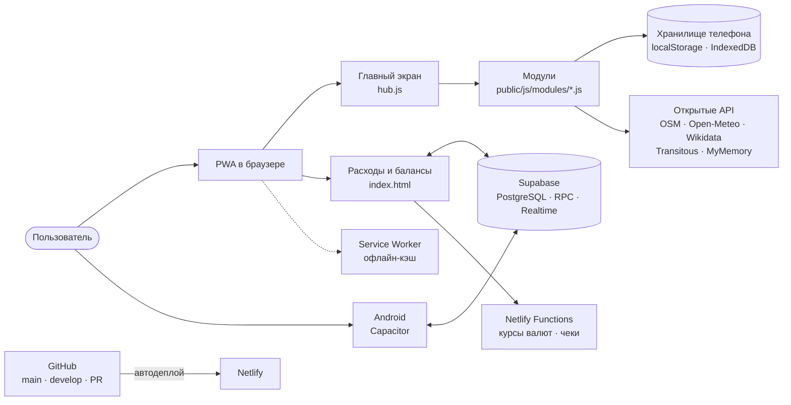

# ✈️ Splitaway Team — помощник для совместных поездок

Приложение для компании, которая едет вместе: делим расходы честно и без таблиц, а всё остальное для поездки — маршрут, бронирования, погода, переводчик, экстренные номера — в одном месте и даже без интернета.

| | |
| --- | --- |
| 🌐 **Сайт (main)** | https://splitaway-team.netlify.app |
| 🧪 **Тестовая версия (develop)** | https://develop--splitaway-team.netlify.app |
| 📋 **Доска задач** | [Splitaway Team Board](https://github.com/users/Rafael-Cologne/projects/3) |
| 🎨 **Макеты Figma** | _ссылка будет добавлена_ |
| 🗄️ **База данных и API** | [docs/ER.md](docs/ER.md) · [docs/API.md](docs/API.md) — _в работе (Александр)_ |

---

## О проекте

### Проблема

После каждой совместной поездки возникает вопрос «кто кому сколько должен?». Люди считают в таблицах и чатах, путаются в валютах и забывают, кто уже вернул деньги. А во время поездки нужно ещё десять приложений: карты, брони, погода, переводчик, номера экстренных служб — и многие из них не работают без интернета или требуют подписку.

### Решение

**Splitaway Team** — одно приложение на всю поездку:

- **Расходы** — кто платил, за кого, в какой валюте; баланс и минимальное число переводов, чтобы рассчитаться.
- **15 сервисов поездки** на главном экране — от гида и маршрута до переводчика и ассистента.
- **Вход без регистрации** — участник выбирает своё имя в поездке по коду или QR.
- **Пара или семья** может считаться одной долей.
- **Работает без интернета** — офлайн-пакет с картой, переводчиком и экстренными номерами.
- **Бесплатно и без рекламы** — используем только бесплатные открытые источники данных, без платных API и ключей.

---

## Команда

| Участник | Роль | Зона ответственности |
| --- | --- | --- |
| **Рафаэль** | Team Lead / Project Manager | Планирование, доска задач, ревью и слияние PR, релизы, сборка Android; модули Календарь, Погода, Чек-лист, Бронирования, Валюты, Дневник, Транспорт, Статистика, Экстренно, Переводчик, Офлайн, KI Ассистент |
| **Александр** | Database / Backend, аналитика | Supabase: схема, SQL-миграции, правила доступа (RLS), ER-диаграмма, API; модуль «Рядом» |
| **Наталья** | Дизайн / UI, QA | Иконки и дизайн, макеты в Figma, светлая и тёмная тема, тестирование интерфейса |
| **Здислав** | Логика и функции, QA | Модули «Гид и места» и «Маршрут», тест-кейсы, баг-репорты |

---

## Функции

### Расходы (ядро приложения)

| Функция | Статус |
| --- | --- |
| Создание поездки, участники, приглашение по коду и QR | ✅ |
| Расход: кто платил, сколько, за кого; поровну, долями или точными суммами | ✅ |
| Пары и семьи как одна доля | ✅ |
| Общая касса | ✅ |
| Баланс и минимальное число переводов, отметка «оплачено» | ✅ |
| Валюта поездки, вторая валюта и конвертер | ✅ |
| Синхронизация между телефонами в реальном времени (Supabase Realtime) | ✅ |
| Скан чека и меню | ✅ |
| Светлая и тёмная тема, русский / английский / немецкий | ✅ |

### Сервисы поездки (плитки на главном экране)

| Плитка | Что умеет | Источник данных | Автор |
| --- | --- | --- | --- |
| 🗺️ **Гид и места** | Достопримечательности, музеи, парки и кафе города на карте, план поездки | OpenStreetMap, Wikipedia | Здислав |
| 🧭 **Маршрут** | Маршрут по сохранённым местам, порядок точек, пешком или на машине | OSRM, OpenStreetMap | Здислав |
| 📍 **Рядом** | Кафе, магазины, заправки в радиусе до 10 км, маршрут до места | Nominatim, Overpass | Александр |
| 📅 **Календарь** | Даты поездки, события, автоматически — брони из «Бронирований» | на устройстве | Рафаэль |
| 🎫 **Бронирования** | Перелёты, жильё, транспорт, билеты; импорт из PDF и фото | PDF.js, Tesseract | Рафаэль |
| 💱 **Валюты** | Курс и конвертер | Frankfurter, нацбанки | Рафаэль |
| ⛅ **Погода** | Прогноз для места поездки | Open-Meteo | Рафаэль |
| ✅ **Чек-лист** | Списки вещей и дел по разделам | на устройстве | Рафаэль |
| 🚌 **Транспорт** | Общественный транспорт от точки до точки, Uber, Bolt, Google Maps | Transitous | Рафаэль |
| 📊 **Статистика** | Итоги, бюджет, траты по дням, категориям и участникам | данные поездки | Рафаэль |
| 🆘 **Экстренно** | SOS, номера служб ~90 стран, больницы рядом, посольства, «Моя информация» с QR | Overpass, Wikidata | Рафаэль |
| 📔 **Дневник** | Записи по дням: текст, фото, голос, место, расходы; «Итоги» и PDF | на устройстве | Рафаэль |
| 🌐 **Переводчик** | Текст с автоопределением языка, голосовой разговор, текст с фото, разговорник (32 фразы × 7 языков), избранное | MyMemory, перевод в Chrome, Tesseract | Рафаэль |
| 📴 **Офлайн** | «Скачать всё»: приложение, карта района, язык страны; честный статус каждой части | OpenStreetMap, кэш браузера | Рафаэль |
| 🤖 **KI Ассистент** | Фраза текстом или голосом → сам понимает, куда добавить (расход, событие, место, пункт чек-листа, запись дневника), создаёт поездку с местной валютой — всё после подтверждения | правила на устройстве, Nominatim | Рафаэль |

> **Без платного AI.** KI Ассистент разбирает фразы правилами прямо на телефоне (сумма, дата, время, имена, ключевые слова) — без токенов и лимитов.

---

## Технологии

| Слой | Что используем |
| --- | --- |
| Интерфейс | JavaScript, HTML, CSS без фреймворка; PWA (ставится на телефон как приложение); иконки Lucide |
| Бэкенд и база | Supabase: PostgreSQL, RPC-функции, правила доступа (RLS), Realtime |
| Серверные функции | Netlify Functions (Node.js): курсы валют, распознавание чеков |
| Офлайн | Service Worker: кэш приложения, карты района и языков; очередь синхронизации расходов |
| Карты | Leaflet + OpenStreetMap |
| Мобильная версия | Capacitor (Android) |
| Хостинг | Netlify — автоматическая публикация из GitHub, превью для каждого PR |
| Командная работа | Git, GitHub Issues, Pull Requests, GitHub Projects |
| Инструменты | VS Code, Claude, Codex, Figma |

### Бесплатные источники данных (без ключей)

OpenStreetMap · Nominatim · Overpass · OSRM · Wikipedia / Wikidata · Open-Meteo · Transitous · MyMemory · Frankfurter · flagcdn.

---

## Архитектура



### Как устроен модуль

Каждая плитка — отдельный файл `public/js/modules/<id>.js`, который подключается одной строкой:

```js
STHub.registerService('weather', ctx => ctx.openScreen({
  title: ctx.title,
  render(body, screen) { body.innerHTML = '...'; }
}));
```

`ctx` даёт модулю всё нужное: открытую поездку, участников, хранилище модуля, доступ к базе, уведомления. Модули не мешают друг другу: свой файл, свои стили с уникальным префиксом, свой ответственный. Шаблон — `public/js/modules/_template.js`.

---

## Как мы работаем с Git

```
Issue → ветка от develop → commit и push → Pull Request в develop
→ ревью другого участника (Approve) → Merge → карточка на доске → Done
```

- `main` — стабильная версия (основной сайт). Обновляется только PR `develop → main`, редко: каждая публикация тратит кредиты Netlify.
- `develop` — рабочая ветка команды, публикуется на тестовый адрес.
- Ветки задач — от `develop`: `feature/<кратко>`, `fix/<кратко>`, `docs/<кратко>`, `design/<кратко>`.
- Напрямую в `main` и `develop` отправить код нельзя — правило GitHub требует PR и 1 одобрение.
- В описании PR пишем `Closes #<номер задачи>` — задача закроется сама после merge.
- Для каждого PR Netlify создаёт превью, ссылка появляется в PR.

---

## Запуск локально

Нужно: [Git](https://git-scm.com), [Node.js LTS](https://nodejs.org), [VS Code](https://code.visualstudio.com).

```bash
git clone https://github.com/Rafael-Cologne/splitaway-team.git
cd splitaway-team
npm install
npm start
```

Откройте http://localhost:3000. На Windows, если PowerShell не запускает `npm`, используйте `npm.cmd start`.

Перед началом каждой задачи:

```bash
git checkout develop
git pull
git checkout -b feature/<кратко>
```

> **Совет.** Если папка проекта лежит в OneDrive, Git может спрашивать «Deletion of directory … failed (y/n)» — отвечайте `n` и дождитесь строки `PS>`. Лучше держать проект вне OneDrive, например в `C:\Projects`.

После обновления приложения обновите страницу **два раза** (`Ctrl+Shift+R`) — так service worker подхватит новую версию.

### Автотесты логики

```bash
node scripts/test-bookings-parse.cjs      # импорт бронирований из текста билетов и подтверждений
node scripts/test-bookings-samples.cjs    # импорт на реальных образцах
node scripts/test-settlement-void.cjs     # отмена погашения долга
node scripts/test-expense-collapse.cjs    # отображение расходов
node scripts/test-fx-rate.cjs             # серверная функция курсов валют
```

В папке `scripts/` есть и другие тесты логики расходов и валют (балансы, долги, конвертер).

---

## Структура проекта

```
public/                 — приложение
  index.html            — расходы, балансы, создание поездки
  js/hub.js             — главный экран и «розетка» для модулей
  js/services-config.js — список плиток
  js/modules/           — модули сервисов (по файлу на плитку)
  js/place-photo.js     — заставка поездки (фото города / флаг страны)
  css/hub.css           — общие стили
  sw.js                 — service worker (офлайн)
  img/, vendor/         — картинки, PDF.js, Tesseract
netlify/functions/      — серверные функции (курсы валют, чеки)
supabase/migrations/    — SQL-миграции базы
android/                — Android-приложение (Capacitor)
scripts/                — автотесты
docs/                   — документация (ER, API, QA)
```

---

## Данные и безопасность

- Никаких ключей и паролей в коде; секреты серверных функций — только в настройках Netlify.
- Доступ к данным поездки — через RPC-функции Supabase и правила RLS по коду приглашения.
- Личные данные «Экстренно» (медкарта, документы) и дневник хранятся только на телефоне.
- Изменения базы — только SQL-миграциями в `supabase/migrations/`.
- Для проверок создаём только тестовые поездки с названием «TEST — …»: база общая.

---

## Статус

🟢 **MVP готов:** расходы и все 15 сервисов работают в `develop`.
Практика: ноябрь — декабрь 2026. Дальше: ER-диаграмма и описание API, QA-отчёт, макеты Figma, общий доступ к броням и дневнику через Supabase, push-уведомления, iOS.
